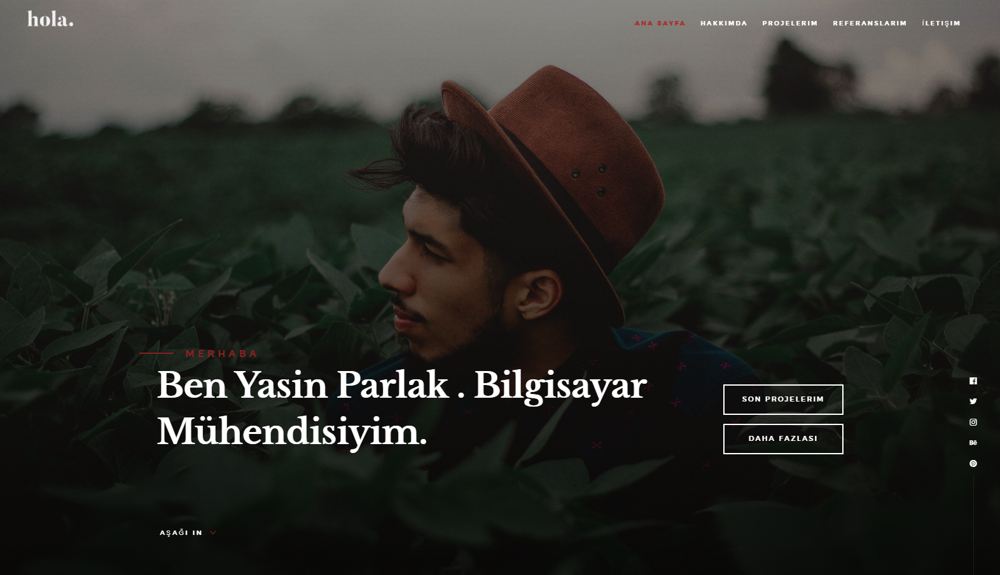
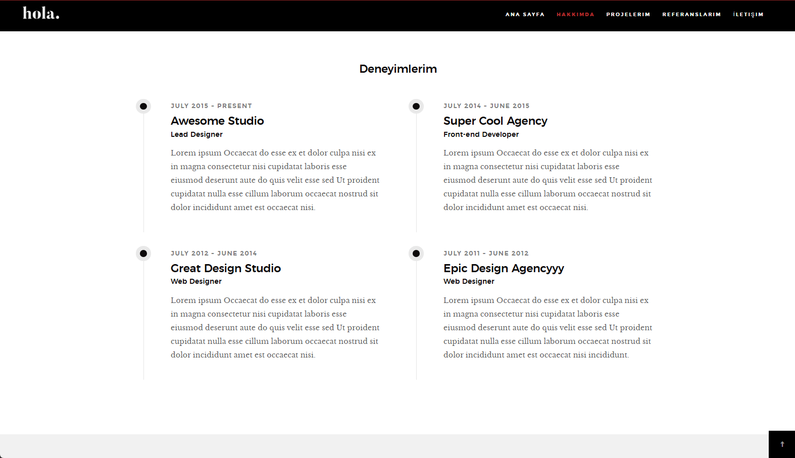
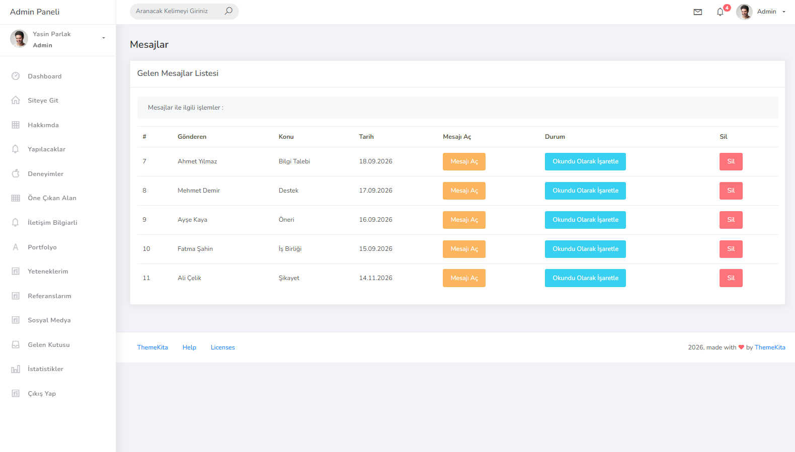

# 🚀 ASP.NET Core MVC Dinamik Portfolyo Projesi

Bu proje, Murat Yücedağ'ın "ASP.NET Core ile Portfolyo Uygulamanızı Geliştirin" adlı Udemy kursu kapsamında modern web geliştirme prensipleriyle geliştirilmiş; dinamik bileşenlere ve yönetim paneline sahip kapsamlı bir kişisel portfolyo web sitesi projesidir.



<br/>


## 🎯 Proje Hakkında

Proje, kişisel portfolio içeriklerini ziyaretçilere sunan ve gelen mesajların yönetilebildiği bir yönetim alanı sağlar. Veriler Entity Framework Core üzerinden SQL Server'da saklanır.

## ✨ Özellikler

- Hakkımda, deneyim, yetenek, portfolio, referans ve iletişim içerileri
- Deneyim kayıtlarını listeleme, ekleme, düzenleme ve silme
- Gelen mesajları görüntüleme, okundu durumunu değiştirme ve silme
- Yapılacaklar listesi oluşturma, güncelleme, silme ve tamamlandı durumunu değiştirme
- Yetenek ve mesaj sayılarını gösteren istatistik ekranı
- Entity Framework Core migration'larıyla veritabanı şeması yönetimi

## 🛠️ Kullanılan Teknolojiler ve Araçlar

Proje geliştirilirken aşağıdaki modern teknoloji ve altyapılar kullanılmıştır:

C# · .NET · ASP.NET Core MVC · Entity Framework Core · SQL Server · LINQ · Razor · Bootstrap · HTML, CSS ve JavaScript

---

<br/>


---

## 📂 Proje Yapısı

```text
MyPortfolioUdemy/
│
├── Controllers/         # MVC Controller sınıfları (Vitrin ve Admin)
├── DAL/                 # Veri Erişim Katmanı (Data Access Layer)
│   ├── Context/         # Entity Framework Core Veritabanı Bağlamı (MyPortfolioContext)
│   └── Entities/        # Veritabanı tabloları (About, Contact, Experience, Portfolio vb.)
├── ViewComponents/      # Modüler parça görünüm sınıfları (About, Works, Contact vb.)
├── Views/               # Razor Görünüm dosyaları (Layout, Default ve Admin panelleri)
└── wwwroot/             # CSS, JavaScript, görseller ve statik dosyalar
 ```
---


<h2 align="center">👨‍💻 Geliştirici</h2>

<p align="center">
  <strong>Ahmet Yasin Parlak</strong> · Bilgisayar Mühendisi
</p>

<p align="center">
  <a href="https://github.com/AhmetYasinParlak">
    
  </a>
  &nbsp;&nbsp;
  <a href="https://www.linkedin.com/in/ahmetyasinparlak/">
    
  </a>
</p>
