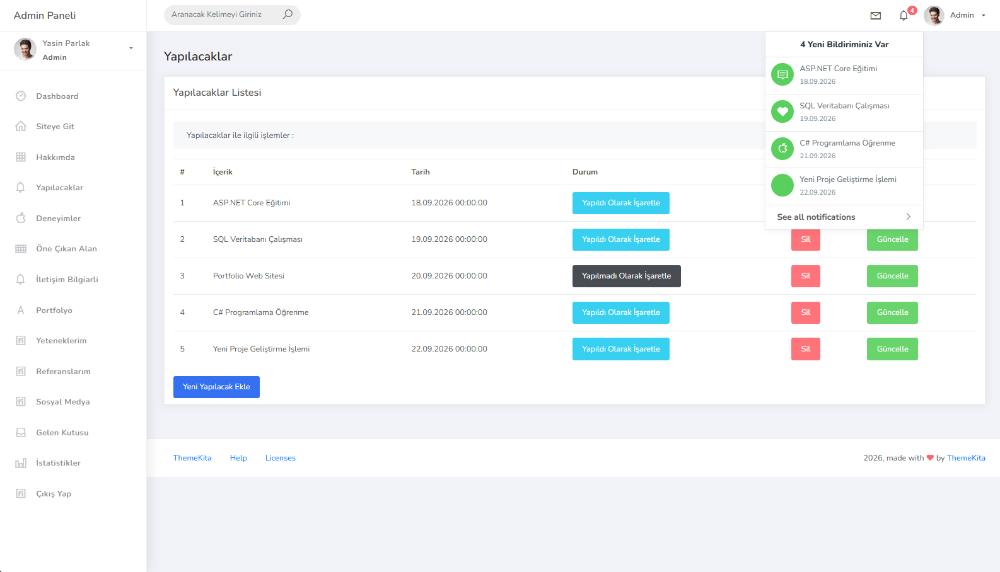

# 🚀 ASP.NET Core MVC Dinamik Portfolyo Projesi

Bu proje, Murat Yücedağ'ın "ASP.NET Core ile Portfolyo Uygulamanızı Geliştirin" adlı Udemy kursu kapsamında modern web geliştirme prensipleriyle geliştirilmiş; dinamik bileşenlere (View Components) ve yönetim paneline sahip kapsamlı bir kişisel portfolyo web sitesi projesidir.


---

## 🛠️ Kullanılan Teknolojiler ve Araçlar

Proje geliştirilirken aşağıdaki modern teknoloji ve altyapılar kullanılmıştır:

C# · .NET · ASP.NET Core MVC · Entity Framework Core · SQL Server · LINQ · Razor · Bootstrap · HTML, CSS ve JavaScript

---

<br/>


## 🌟 Projenin Öne Çıkan Özellikleri

* **Modüler Mimari (View Components):** Ana sayfa üzerindeki Hakkımda, Projeler, İletişim, Referanslar ve İstatistikler gibi alanlar tamamen bağımsız View Component yapılarıyla yönetilmektedir.
* **Dinamik İçerik Yönetimi:** Ziyaretçilerin bıraktığı mesajlar, projeler, yetenekler ve hakkımda bilgileri veritabanından dinamik olarak çekilir ve yönetilir.
* **Responsive Tasarım:** Mobil cihazlar, tabletler ve masaüstü ekranlarla tam uyumlu, şık bir kullanıcı arayüzü.
* **Smooth Scroll & Animasyonlar:** Sayfa içi akıcı kaydırma (smooth scroll) ve duyarlı menü (active/current class yönetimi) entegrasyonu.

---

## 📂 Proje Mimarisi (Solution Explorer)

```text
MyPortfolioUdemy/
│
├── Controllers/         # MVC Controller sınıfları
├── Models/              # Veritabanı modelleri ve View Model sınıfları
├── DAL/                 # Veritabanı bağlamı (Context) ve veri erişim katmanı
├── ViewComponents/      # Modüler parça görünüm sınıfları (About, Works, Contact vb.)
├── Views/               # Razor Görünüm dosyaları (Layout ve Component görünümleri)
└── Program.cs           # Servis ve uygulama ayarları


